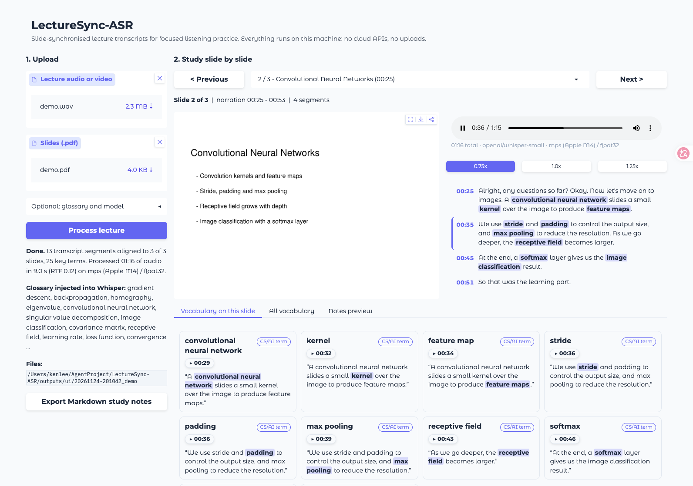
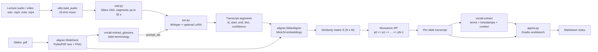

# LectureSync-ASR

**English** | [简体中文](README.zh-CN.md)

Local, PyTorch-based alignment of lecture recordings with PDF slides, plus accent-robust
transcription and a listening-practice workbench for CS/AI students.



## Why

Graduate CS/AI lectures are hard to follow for non-native English speakers: lecturers
speak with many accents (Australian, Indian, European...), the vocabulary is dense with
jargon, platform auto-captions get exactly those words wrong, and finding "the part
where slide 23 was explained" in a 90-minute recording means scrubbing a progress bar.

LectureSync-ASR takes a recording (or video) and the slide deck and produces, entirely
on your own machine:

- a transcript in which every sentence is attached to the slide it explains,
- CS/AI terminology highlighted, with the timestamp and sentence where each term is said,
- a web workbench where choosing a slide cues the audio to that slide, with
  0.75x / 1.0x / 1.25x playback for intensive listening,
- Markdown study notes structured slide by slide.

No cloud API and no API key are involved. Model weights are downloaded once from the
Hugging Face Hub / GitHub on first use; after that the tool runs offline
(`HF_HUB_OFFLINE=1`).

## Highlights

| Area | What is implemented |
| --- | --- |
| Device handling | One `DeviceManager` selects `mps` -> `cuda` -> `cpu`. `float16` on CUDA; on MPS `float32` by default, `float16` only after an operator probe, with automatic fallback to `float32` if decoding fails at runtime. |
| VAD | Silero VAD through `torch.hub`, with offline fallbacks (hub cache -> `silero-vad` wheel -> energy detector). Pauses under 0.8 s are merged; segments are capped at 30 s and cut at the quietest frame. |
| ASR | Hugging Face Whisper (`openai/whisper-small` by default), optional PEFT LoRA adapter, slide terminology injected via `prompt_ids`, phrase-level timestamps, per-segment confidence. |
| Alignment | MiniLM sentence embeddings, an `N x M` cosine-similarity matrix and a monotonic dynamic program with a jump penalty. |
| Vocabulary | Built-in CS/AI lexicon and academic word list, RAKE-style noun phrases and TF-IDF over slides; each term carries timestamps and its spoken sentence. |
| Fine-tuning | Plain PyTorch loop with LoRA on `q_proj`/`v_proj`, gradient accumulation, `fp16`/`bf16` autocast, sized for a free Colab T4. |
| Evaluation | WER and technical-term recall (base vs. LoRA, with and without glossary prompt); latency, RTF and peak RSS with correct MPS/CUDA synchronisation. |
| UI | Gradio workbench on `http://127.0.0.1:7860`. |

## Architecture



| Module | Responsibility |
| --- | --- |
| `src/utils.py` | Config loading, `DeviceManager`, GPU-synchronised timing, audio decoding (soundfile / ffmpeg / macOS `afconvert`), logging |
| `src/vad.py` | Speech segmentation: `SpeechSegment(start_sec, end_sec, audio_tensor)` |
| `src/asr.py` | Whisper inference, LoRA loading, glossary prompt, timestamps, confidence |
| `src/aligner.py` | PDF text/image extraction, embeddings, similarity matrix, monotonic DP |
| `src/vocab.py` | Glossary for prompting, study vocabulary, highlighting, term-recall metric |
| `src/pipeline.py` | Orchestration of the stages, Markdown export, CLI |
| `src/train_lora.py` | LoRA fine-tuning |
| `eval/benchmark.py` | Accuracy and latency benchmarks |
| `app/ui.py` | Gradio application |
| `tests/test_pipeline.py` | End-to-end smoke tests on generated inputs |

### The alignment objective

Every transcript segment `i` gets one slide `p_i`. With the similarity matrix `S`, the
aligner maximises

```
sum_i S[i, p_i]  -  lambda * sum_i jump_penalty(p_i - p_{i-1})      s.t.  p_0 <= p_1 <= ... <= p_{N-1}
```

where `jump_penalty(d)` is `0` for staying on the slide, `1` for moving to the next one
and `1 + skip_penalty * (d - 1)` when slides are skipped. The recurrence is

```
D[0, p] = S[0, p] - lambda * pen(p)
D[i, p] = S[i, p] + max_{q <= p} ( D[i-1, q] - lambda * pen(p - q) )
```

solved in `O(N * M^2)` time (vectorised over `M^2` in NumPy) with back-pointers.

A per-segment `argmax` flickers whenever a lecturer mentions something from another
slide ("we will see transformers later"). The monotonic constraint rules out going
back, and the jump penalty makes moving forward cost something, so the path advances
only when the following segments keep supporting the new slide.

### Design decisions

- **Confidence without `generate` internals.** The return format of Whisper's
  `generate` differs between transformers releases and between timestamp and
  non-timestamp decoding. Confidence is therefore computed with one teacher-forced
  decoder pass over the generated tokens, reusing the encoder output (a few percent of
  extra time), and reported as the geometric mean token probability.
- **Context only where it helps.** Utterances shorter than 12 words borrow their
  neighbours before embedding; longer segments are embedded alone. Concatenating
  neighbours everywhere blurred slide boundaries in testing.
- **Semantic + lexical similarity.** `S` blends MiniLM cosine similarity with a TF-IDF
  cosine (weight 0.25) so exact technical terms shared by speech and slide count.
- **VAD stays on the CPU.** Silero is a 2 MB recurrent model that runs faster than real
  time on one core; keeping it on the CPU removes a class of cross-device tensor bugs.
- **Nested terms.** "neural network" inside "convolutional neural network" is not
  counted as a separate use of the shorter term.

## Quick start

Requirements: Python 3.12 (the pinned versions in `requirements.txt` were tested on
3.12) and about 1.5 GB of disk space for model weights.
`ffmpeg` is optional: `.wav`/`.flac`/`.mp3` decode through `soundfile`, and on macOS
`.m4a`/`.mp4` decode through the built-in `afconvert`. On Linux install `ffmpeg` to read
video containers.

```bash
git clone https://github.com/KristianLi/LectureSync-ASR.git
cd LectureSync-ASR
python3 -m venv .venv
source .venv/bin/activate
pip install -r requirements.txt
```

Verify the installation (generates a mock 2-page slide deck and test audio, then runs
the whole pipeline; about 20 s on an M4 after the models are cached):

```bash
pytest
```

Launch the workbench and open <http://127.0.0.1:7860>:

```bash
python app/ui.py
```

Or use the command line:

```bash
python -m src.pipeline --audio lecture.mp4 --pdf slides.pdf --out outputs/lecture05
```

This writes `notes.md`, `result.json`, the rendered slides and a 16 kHz WAV to the
output directory. Useful options:

```bash
# Smaller, faster model
python -m src.pipeline --audio lecture.mp4 --pdf slides.pdf --set asr.model_name=openai/whisper-tiny

# Fine-tuned adapter and your own glossary (one term per line)
python -m src.pipeline --audio lecture.mp4 --pdf slides.pdf --lora checkpoints/whisper-small-lora-edacc --glossary terms.txt
```

### Using the workbench

1. Upload the recording or video and the PDF. Optionally add a glossary file or type
   extra terms, pick a Whisper size, or point to a LoRA adapter directory.
2. Press **Process lecture**.
3. Move between slides with **Previous** / **Next** or the selector. The transcript
   panel shows only the sentences aligned to the current slide and the player is cued to
   the start of its narration.
4. Click a transcript line or a vocabulary card to replay that sentence. Use the
   0.75x / 1.0x / 1.25x buttons for slower or faster listening. Lines with low ASR
   confidence are dotted-underlined: those are the places worth listening to twice.
5. **Export Markdown study notes** downloads the per-slide notes.

## Configuration

All settings live in [`configs/default.yaml`](configs/default.yaml) and can be
overridden with `--config my.yaml` or `--set section.key=value`.

| Key | Default | Meaning |
| --- | --- | --- |
| `runtime.device` | `auto` | `auto`, `mps`, `cuda` or `cpu` |
| `runtime.dtype` | `auto` | `float16` on MPS is probed first and falls back to `float32` |
| `vad.min_silence_sec` | `0.8` | Pauses shorter than this are merged |
| `vad.max_segment_sec` | `30.0` | Upper bound for one speech segment |
| `asr.model_name` | `openai/whisper-small` | Any Whisper checkpoint on the Hub |
| `asr.lora_checkpoint` | `null` | PEFT adapter directory |
| `asr.prompt_max_tokens` | `120` | Token budget of the glossary prompt |
| `aligner.embedding_model` | `sentence-transformers/all-MiniLM-L6-v2` | Sentence encoder |
| `aligner.jump_penalty` | `0.12` | `lambda` in the objective above |
| `aligner.skip_penalty` | `0.5` | Extra cost per skipped slide, in units of `lambda` |
| `aligner.lexical_weight` | `0.25` | TF-IDF share of the similarity |
| `lora.*` | | Rank, alpha, learning rate, batch size, accumulation, precision |

## Fine-tuning Whisper with LoRA

```bash
# Quick wiring check on any machine (whisper-tiny, synthetic audio, 2 steps)
python -m src.train_lora --smoke-test

# Accented English (EdAcc) on a free Colab T4: fp16, effective batch size 16
python -m src.train_lora --dataset edinburghcstr/edacc --precision fp16 \
    --batch-size 8 --grad-accum-steps 2 --max-steps 1000

# Your own data: JSONL or CSV with "audio" and "text" columns
python -m src.train_lora --manifest data/train.jsonl --eval-manifest data/dev.jsonl
```

Notes:

- `edinburghcstr/edacc` ships `validation` (9,848 utterances) and `test` (9,289)
  splits and is about 7 GB. The defaults train on `validation` and report on `test`.
- Audio is decoded with `soundfile` from the raw dataset bytes, so `torchcodec` is not
  required.
- `--precision auto` picks `fp16` with a gradient scaler on CUDA and `fp32` on MPS/CPU.
  `bf16` is available on GPUs that support it.
- Only the adapter is saved (a few MB). Load it with `--lora <dir>` or
  `asr.lora_checkpoint`.

## Evaluation

```bash
# WER + technical-term recall: base vs. LoRA, with and without the glossary prompt
python eval/benchmark.py accuracy --dataset edinburghcstr/edacc --split test \
    --max-samples 200 --lora checkpoints/whisper-small-lora-edacc --with-prompt

# Latency, RTF and peak memory on this machine
python eval/benchmark.py latency --audio path/to/30s_lecture_clip.wav --runs 20
```

Both commands print a Markdown table and save the raw numbers to `eval/results/`.

**Term recall** counts, for every term of the built-in CS/AI lexicon (or `--terms
file`), how many of its occurrences in the reference transcripts also appear in the
hypothesis. It isolates the errors that matter most to a student: a transcript can have
a low WER and still write "each envelope" where the lecturer said "eigenvalue".

**Latency methodology.** Each run decodes one clip through the full ASR path (feature
extraction, encoder, autoregressive decoding, confidence scoring) after warm-up runs.
MPS and CUDA execute asynchronously, so `torch.mps.synchronize()` /
`torch.cuda.synchronize()` is called immediately before the timer starts and again
before it stops. `RTF = avg latency / clip duration`. Peak RSS is sampled with `psutil`
every 20 ms during the measured runs; on Apple Silicon model weights live in Metal
driver memory, which the script reports separately (`mps_driver_mb`).

### Results

Cells marked `TBD` or `TBD-M1` are **placeholders, not measurements**: `TBD-M1` = to be
measured on an M1 MacBook Air, `TBD` = to be measured on the machine that runs the
accuracy benchmark. The Mac mini (M4) rows of the latency table are measured values.

**Recognition accuracy** - `openai/whisper-small`, EdAcc `test`, 200 utterances
(`eval/benchmark.py accuracy ... --with-prompt`)

| System | WER (%) | Term recall (%) | RTF |
| --- | ---: | ---: | ---: |
| Base Whisper | `TBD` | `TBD` | `TBD` |
| Base Whisper + glossary prompt | `TBD` | `TBD` | `TBD` |
| LoRA Whisper | `TBD` | `TBD` | `TBD` |
| LoRA Whisper + glossary prompt | `TBD` | `TBD` | `TBD` |

**Inference latency and memory** - `openai/whisper-small`, one 30 s lecture clip, 20
runs after 3 warm-up runs (`eval/benchmark.py latency --audio <clip>`)

| Machine | Backend | dtype | avg_ms | p95_ms | RTF | Peak RSS (MB) |
| --- | --- | --- | ---: | ---: | ---: | ---: |
| MacBook Air (M1) | `mps` | float32 | `TBD-M1` | `TBD-M1` | `TBD-M1` | `TBD-M1` |
| MacBook Air (M1) | `cpu` | float32 | `TBD-M1` | `TBD-M1` | `TBD-M1` | `TBD-M1` |
| Mac mini (M4, 16 GB) | `mps` | float32 | 2165 | 2174 | 0.072 | 656 |
| Mac mini (M4, 16 GB) | `mps` | float16 | 1482 | 1490 | 0.049 | 740 |
| Mac mini (M4, 16 GB) | `cpu` | float32 | 3319 | 3335 | 0.111 | 1790 |

Notes on the Mac mini (M4) rows, measured on 2026-11-24 with PyTorch 2.15.0:

- The clip is the first 30 s of a lecture synthesised with the macOS `say` command, not
  a real classroom recording; each run decodes 166 text tokens. Latency grows with the
  amount of speech in the clip, so re-measure with your own recording before quoting
  these numbers for real lectures.
- Peak RSS excludes Metal driver memory, which is where the weights live on MPS:
  1447 MB (`float32`) and 1255 MB (`float16`) were reported as `mps_driver_mb`. The CPU
  row has no such second pool, which is why its RSS is higher.
- `float16` on MPS produced the same transcript as `float32` on this machine. It stays
  opt-in (`--dtype float16` / `runtime.dtype: float16`) because that is not guaranteed
  on every macOS and chip combination.

To fill a row, run the latency command on that machine (add `--device cpu` or
`--dtype float16` for the other variants) and copy the printed table row.

## Tests

`pytest` runs 14 tests in `tests/test_pipeline.py`:

- generated fixtures: a two-page CS deck (PyMuPDF) and a speech-shaped WAV (NumPy + soundfile),
- VAD rules: a 0.4 s pause is merged, a 1.5 s pause splits, 70 s of speech is cut into
  pieces of at most 30 s,
- the DP: monotonic output, robustness to distractor segments, and optimality against
  brute-force enumeration,
- the full `VAD -> ASR -> Aligner -> Vocab` chain on the auto-detected device and on
  CPU, asserting output schemas and that models and tensors sit on the expected device,
- LoRA adapter loading (merged and as a live adapter),
- on macOS, a spoken two-topic lecture synthesised with `say`: both slides must be
  found, the page turn must fall at the topic change, and terms must carry timestamps
  on the correct slide.

Whisper-tiny is used to keep the run short; `LECTURESYNC_TEST_MODEL=openai/whisper-small pytest`
tests the default model.

## Limitations

- **Monotonic assumption.** A lecturer who goes back to an earlier slide is not
  modelled; that narration stays with the current slide.
- **Bridge sentences.** A content-free sentence at a slide change ("okay, next topic")
  can land on either side of the page turn.
- **Image-only slides** have no text to match and are skipped unless neighbouring
  evidence forces the path through them.
- **Timestamps.** Phrase boundaries come from Whisper's timestamp tokens (20 ms
  resolution). Phrases longer than 12 s are cut at sentence ends by interpolation, and
  the time of a term inside a phrase is interpolated from its character position, so
  both are accurate to roughly a second.
- **Vocabulary extraction is lexicon- and heuristic-based** (no part-of-speech tagger),
  and English only.
- **Mixed-precision training** is enabled on CUDA only; MPS and CPU train in `fp32`.

## Troubleshooting

- *First run is slow or fails offline.* Models are downloaded on first use: Whisper
  small (about 1 GB), MiniLM (about 90 MB), Silero VAD (about 2 MB).
- *`.m4a`/`.mp4` cannot be decoded on Linux.* Install `ffmpeg`.
- *`torch.hub` certificate errors on macOS.* The VAD loader points OpenSSL at the
  `certifi` bundle automatically; if the hub is still unreachable it falls back to the
  `silero-vad` wheel, and then to an energy detector, and logs which backend is used.
- *An operator is not implemented on MPS.* `PYTORCH_ENABLE_MPS_FALLBACK=1` is set by
  `src/utils.py` before PyTorch is imported, so such operators run on the CPU.

## Repository layout

```text
LectureSync-ASR/
├── README.md / README.zh-CN.md
├── requirements.txt
├── configs/default.yaml
├── src/
│   ├── utils.py        # device manager, audio loading, config, logging
│   ├── vad.py          # Silero VAD wrapper
│   ├── asr.py          # Whisper + LoRA + glossary prompt
│   ├── aligner.py      # PDF extraction, embeddings, monotonic DP
│   ├── vocab.py        # terminology extraction
│   ├── pipeline.py     # orchestration, Markdown export, CLI
│   └── train_lora.py   # LoRA fine-tuning
├── eval/benchmark.py   # WER, term recall, latency, memory
├── app/ui.py           # Gradio workbench
└── tests/test_pipeline.py
```

## License

Released under the [MIT License](LICENSE). Model weights and datasets keep their own
licenses (Whisper: MIT; all-MiniLM-L6-v2: Apache-2.0; Silero VAD: MIT; for EdAcc see
its dataset card).
