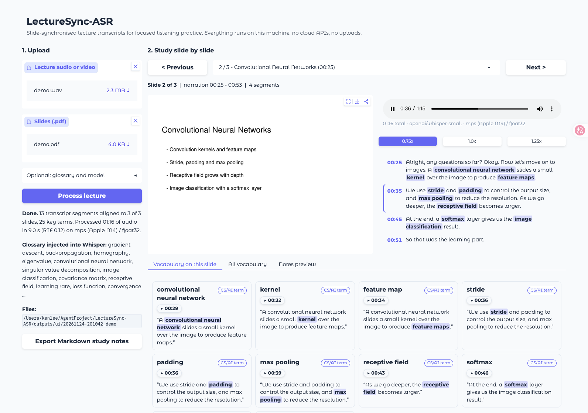
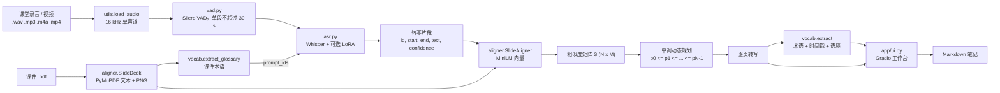

# LectureSync-ASR

[English](README.md) | **简体中文**

基于 PyTorch 的本地课件音画对齐工具：把课堂录音与 PDF 课件逐页对齐，提供更抗口音的转写，
并附带一个面向 CS/AI 学生的英语精听工作台。



## 为什么做这个项目

对母语非英语的 CS/AI 研究生来说，听课有几个实际困难：老师口音各异（澳洲、印度、欧洲等），
专业术语密集，平台自带字幕恰恰在这些术语上出错；课后想找“第 23 页那段讲解”，只能在 90
分钟的录音里反复拖进度条。

LectureSync-ASR 输入一段录音（或视频）和对应课件，完全在本机生成：

- 逐句转写，每句话都挂在它所讲解的那一页课件上；
- 自动高亮的 CS/AI 术语，并标出老师说出该词的时间戳和原句；
- 一个网页工作台：选中某页课件，音频自动定位到该页的讲解起点，支持 0.75x / 1.0x / 1.25x
  三档倍速精听；
- 按课件页码组织的 Markdown 复习笔记。

全程不调用任何云端 API，也不需要 API Key。模型权重在首次运行时从 Hugging Face Hub /
GitHub 下载一次，之后可完全离线运行（`HF_HUB_OFFLINE=1`）。

## 功能概览

| 方面 | 实现内容 |
| --- | --- |
| 设备管理 | 统一的 `DeviceManager`，按 `mps` -> `cuda` -> `cpu` 选择设备。CUDA 用 `float16`；MPS 默认 `float32`，只有通过算子探测后才启用 `float16`，运行时解码失败会自动回退到 `float32`。 |
| VAD | 通过 `torch.hub` 加载 Silero VAD，离线时依次回退（hub 缓存 -> `silero-vad` 安装包 -> 能量检测）。短于 0.8 s 的停顿会被合并；单段不超过 30 s，超长时在最安静的一帧切开。 |
| ASR | Hugging Face Whisper（默认 `openai/whisper-small`），可选加载 PEFT LoRA 适配器，通过 `prompt_ids` 注入课件术语，输出短语级时间戳和每段置信度。 |
| 对齐 | MiniLM 句向量、`N x M` 余弦相似度矩阵，以及带翻页惩罚的单调动态规划。 |
| 词汇 | 内置 CS/AI 核心词库与学术词表，结合 RAKE 式名词短语和课件 TF-IDF；每个词附带时间戳与原句。 |
| 微调 | 纯 PyTorch 训练循环，对 `q_proj`/`v_proj` 做 LoRA，支持梯度累积与 `fp16`/`bf16` 混合精度，适配免费 Colab T4。 |
| 评测 | WER 与专业术语召回率（原始模型对比 LoRA，是否使用术语提示）；推理延迟、RTF、峰值 RSS，计时前后正确同步 MPS/CUDA。 |
| 界面 | Gradio 工作台，地址 `http://127.0.0.1:7860`。 |

## 系统架构



| 模块 | 职责 |
| --- | --- |
| `src/utils.py` | 配置加载、`DeviceManager`、带 GPU 同步的计时、音频解码（soundfile / ffmpeg / macOS `afconvert`）、日志 |
| `src/vad.py` | 语音切分：`SpeechSegment(start_sec, end_sec, audio_tensor)` |
| `src/asr.py` | Whisper 推理、LoRA 加载、术语提示、时间戳、置信度 |
| `src/aligner.py` | PDF 文本与图像提取、向量编码、相似度矩阵、单调 DP |
| `src/vocab.py` | 提示用术语表、学习词汇、高亮、术语召回率指标 |
| `src/pipeline.py` | 串联各阶段、导出 Markdown、命令行入口 |
| `src/train_lora.py` | LoRA 微调 |
| `eval/benchmark.py` | 准确率与延迟评测 |
| `app/ui.py` | Gradio 应用 |
| `tests/test_pipeline.py` | 基于自动生成输入的端到端冒烟测试 |

### 对齐目标函数

每条转写片段 `i` 分配一页课件 `p_i`。给定相似度矩阵 `S`，对齐器最大化

```
sum_i S[i, p_i]  -  lambda * sum_i jump_penalty(p_i - p_{i-1})      约束  p_0 <= p_1 <= ... <= p_{N-1}
```

其中 `jump_penalty(d)`：停留在当前页为 `0`，翻到下一页为 `1`，跳过若干页为
`1 + skip_penalty * (d - 1)`。递推式为

```
D[0, p] = S[0, p] - lambda * pen(p)
D[i, p] = S[i, p] + max_{q <= p} ( D[i-1, q] - lambda * pen(p - q) )
```

时间复杂度 `O(N * M^2)`（`M^2` 部分用 NumPy 向量化），通过回溯指针恢复最优路径。

如果逐句取 `argmax`，只要老师提到别的页的内容（“后面我们会讲 transformer”），页码就会来回
跳。单调约束禁止回跳；翻页惩罚让“往前翻”有代价，因此只有后续片段持续支持新的一页时，路径
才会前进。

### 设计取舍

- **置信度不依赖 `generate` 的内部返回格式。** Whisper `generate` 的返回结构在不同
  transformers 版本之间、在带时间戳与不带时间戳的解码之间都不一样。因此置信度由一次
  teacher-forced 解码前向计算得到，复用编码器输出（额外耗时为百分之几），取各 token 概率的
  几何平均。
- **只在需要时补充上下文。** 少于 12 个词的短句在编码前会借用相邻片段；较长的片段单独编码。
  测试中发现，对所有片段都拼接相邻句会模糊翻页边界。
- **语义相似度 + 词面相似度。** `S` 由 MiniLM 余弦相似度与 TF-IDF 余弦（权重 0.25）混合，
  让语音与课件共有的专业术语起到作用。
- **VAD 固定在 CPU 上。** Silero 是约 2 MB 的循环网络，单核即可快于实时；放在 CPU 上可以避免
  一类跨设备张量错误。
- **嵌套术语。** “convolutional neural network” 中的 “neural network” 不计为后者的独立出现。

## 快速开始

环境要求：Python 3.12（`requirements.txt` 中锁定的版本在 3.12 上测试），模型权重约占 1.5 GB
磁盘。`ffmpeg` 为可选：`.wav`/`.flac`/`.mp3` 由 `soundfile` 解码，macOS 上 `.m4a`/`.mp4` 由系统
自带的 `afconvert` 解码。Linux 上读取视频容器需要安装 `ffmpeg`。

```bash
git clone <your-fork-url> LectureSync-ASR
cd LectureSync-ASR
python3 -m venv .venv
source .venv/bin/activate
pip install -r requirements.txt
```

验证安装（自动生成 2 页模拟课件与测试音频并跑通全流程；模型缓存后在 M4 上约 20 秒）：

```bash
pytest
```

启动工作台并打开 <http://127.0.0.1:7860>：

```bash
python app/ui.py
```

或使用命令行：

```bash
python -m src.pipeline --audio lecture.mp4 --pdf slides.pdf --out outputs/lecture05
```

输出目录中会生成 `notes.md`、`result.json`、渲染后的课件图片和 16 kHz WAV。常用选项：

```bash
# 更小更快的模型
python -m src.pipeline --audio lecture.mp4 --pdf slides.pdf --set asr.model_name=openai/whisper-tiny

# 使用微调后的适配器和自定义术语表（每行一个词）
python -m src.pipeline --audio lecture.mp4 --pdf slides.pdf --lora checkpoints/whisper-small-lora-edacc --glossary terms.txt
```

### 工作台使用方法

1. 上传录音或视频以及 PDF 课件。可选：上传术语表或直接输入额外术语、选择 Whisper 模型大小、
   填写 LoRA 适配器目录。
2. 点击 **Process lecture**。
3. 用 **Previous** / **Next** 或下拉框切换课件页。逐字稿面板只显示映射到当前页的句子，播放器
   自动定位到该页讲解的起点。
4. 点击某一行逐字稿或某张词汇卡片即可重听该句。用 0.75x / 1.0x / 1.25x 按钮调整倍速。
   带虚线下划线的行是 ASR 置信度较低的地方，值得多听一遍。
5. 点击 **Export Markdown study notes** 下载按页整理的笔记。

## 配置

所有设置位于 [`configs/default.yaml`](configs/default.yaml)，可用 `--config my.yaml` 或
`--set section.key=value` 覆盖。

| 配置项 | 默认值 | 含义 |
| --- | --- | --- |
| `runtime.device` | `auto` | `auto`、`mps`、`cuda` 或 `cpu` |
| `runtime.dtype` | `auto` | MPS 上的 `float16` 会先探测，失败则回退 `float32` |
| `vad.min_silence_sec` | `0.8` | 短于该值的停顿会被合并 |
| `vad.max_segment_sec` | `30.0` | 单个语音片段的时长上限 |
| `asr.model_name` | `openai/whisper-small` | Hub 上任意 Whisper 模型 |
| `asr.lora_checkpoint` | `null` | PEFT 适配器目录 |
| `asr.prompt_max_tokens` | `120` | 术语提示的 token 预算 |
| `aligner.embedding_model` | `sentence-transformers/all-MiniLM-L6-v2` | 句向量模型 |
| `aligner.jump_penalty` | `0.12` | 上述目标函数中的 `lambda` |
| `aligner.skip_penalty` | `0.5` | 每跳过一页的额外代价（以 `lambda` 为单位） |
| `aligner.lexical_weight` | `0.25` | TF-IDF 在相似度中的占比 |
| `lora.*` | | 秩、alpha、学习率、批大小、梯度累积、精度 |

## 用 LoRA 微调 Whisper

```bash
# 任意机器上的快速连通性检查（whisper-tiny、合成音频、2 步）
python -m src.train_lora --smoke-test

# 在免费 Colab T4 上用多口音英语数据集 EdAcc 训练：fp16，等效批大小 16
python -m src.train_lora --dataset edinburghcstr/edacc --precision fp16 \
    --batch-size 8 --grad-accum-steps 2 --max-steps 1000

# 自有数据：包含 "audio" 和 "text" 两列的 JSONL 或 CSV
python -m src.train_lora --manifest data/train.jsonl --eval-manifest data/dev.jsonl
```

说明：

- `edinburghcstr/edacc` 只有 `validation`（9,848 条）和 `test`（9,289 条）两个划分，约 7 GB。
  默认在 `validation` 上训练、在 `test` 上评测。
- 音频直接用 `soundfile` 从数据集的原始字节解码，不依赖 `torchcodec`。
- `--precision auto` 在 CUDA 上选择带梯度缩放的 `fp16`，在 MPS/CPU 上选择 `fp32`；支持的 GPU
  上可用 `bf16`。
- 只保存适配器权重（几 MB）。推理时用 `--lora <dir>` 或 `asr.lora_checkpoint` 加载。

## 评测

```bash
# WER + 专业术语召回率：原始模型对比 LoRA，以及是否使用术语提示
python eval/benchmark.py accuracy --dataset edinburghcstr/edacc --split test \
    --max-samples 200 --lora checkpoints/whisper-small-lora-edacc --with-prompt

# 当前设备上的延迟、RTF 与峰值内存
python eval/benchmark.py latency --audio path/to/30s_lecture_clip.wav --runs 20
```

两条命令都会打印 Markdown 表格，并把原始数据保存到 `eval/results/`。

**术语召回率**：对内置 CS/AI 词库（或 `--terms file` 指定的词表）中的每个术语，统计它在参考
文本中的出现有多少也出现在识别结果里。它衡量的是对学生影响最大的错误：WER 很低的转写仍然
可能把 “eigenvalue” 写成 “each envelope”。

**延迟测量方法**：预热若干次后，每次测量完整解码一个片段（特征提取、编码器、自回归解码、
置信度计算）。MPS 和 CUDA 是异步执行的，因此在计时开始前和结束前都会调用
`torch.mps.synchronize()` / `torch.cuda.synchronize()`。`RTF = 平均延迟 / 片段时长`。峰值 RSS
在测量期间用 `psutil` 每 20 ms 采样一次；在 Apple Silicon 上模型权重位于 Metal 驱动内存中，
脚本会单独报告（`mps_driver_mb`）。

### 结果

下面的表格是**模板**：其中没有任何数字是已经实测的。每个单元格都是占位符，需要在对应机器上
实测后填入：`TBD-M1` = 待在 M1 MacBook Air 上实测，`TBD-M4` = 待在 M4 Mac mini 上实测，
`TBD` = 待在运行准确率评测的机器上实测。

**识别准确率** - `openai/whisper-small`，EdAcc `test`，200 条语音
（`eval/benchmark.py accuracy ... --with-prompt`）

| 系统 | WER (%) | 术语召回率 (%) | RTF |
| --- | ---: | ---: | ---: |
| 原始 Whisper | `TBD` | `TBD` | `TBD` |
| 原始 Whisper + 术语提示 | `TBD` | `TBD` | `TBD` |
| LoRA Whisper | `TBD` | `TBD` | `TBD` |
| LoRA Whisper + 术语提示 | `TBD` | `TBD` | `TBD` |

**推理延迟与内存** - `openai/whisper-small`，一段 30 s 课堂片段，预热 3 次后测量 20 次
（`eval/benchmark.py latency --audio <clip>`）

| 机器 | 后端 | dtype | avg_ms | p95_ms | RTF | 峰值 RSS (MB) |
| --- | --- | --- | ---: | ---: | ---: | ---: |
| MacBook Air (M1) | `mps` | float32 | `TBD-M1` | `TBD-M1` | `TBD-M1` | `TBD-M1` |
| MacBook Air (M1) | `cpu` | float32 | `TBD-M1` | `TBD-M1` | `TBD-M1` | `TBD-M1` |
| Mac mini (M4) | `mps` | float32 | `TBD-M4` | `TBD-M4` | `TBD-M4` | `TBD-M4` |
| Mac mini (M4) | `mps` | float16 | `TBD-M4` | `TBD-M4` | `TBD-M4` | `TBD-M4` |
| Mac mini (M4) | `cpu` | float32 | `TBD-M4` | `TBD-M4` | `TBD-M4` | `TBD-M4` |

填写方法：在对应机器上运行延迟评测命令（其他变体加上 `--device cpu` 或 `--dtype float16`），
把打印出的表格行复制进来。

## 测试

`pytest` 会运行 `tests/test_pipeline.py` 中的 14 个测试：

- 自动生成的输入：2 页 CS 课件（PyMuPDF）和一段类语音 WAV（NumPy + soundfile）；
- VAD 规则：0.4 s 的停顿被合并，1.5 s 的停顿被切开，70 s 的连续语音被切成不超过 30 s 的片段；
- 动态规划：输出单调、对干扰片段鲁棒，并与暴力枚举的最优解一致；
- 在自动检测到的设备和 CPU 上分别跑通 `VAD -> ASR -> Aligner -> Vocab` 全流程，检查输出
  结构以及模型和张量是否位于预期设备；
- LoRA 适配器加载（合并权重与保留适配器两种方式）；
- 在 macOS 上，用系统 `say` 命令合成一段包含两个主题的讲解：两页课件都必须被找到，翻页点
  必须落在主题切换处，术语必须带有时间戳并落在正确的页上。

为缩短运行时间默认使用 whisper-tiny；`LECTURESYNC_TEST_MODEL=openai/whisper-small pytest`
可测试默认模型。

## 已知局限

- **单调假设。** 老师翻回前面某一页的情况没有建模，这段讲解会留在当前页。
- **过渡句。** 翻页处没有实质内容的句子（“好，下一个话题”）可能落在翻页点的任意一侧。
- **纯图片页**没有可匹配的文本，除非前后证据迫使路径经过，否则会被跳过。
- **时间戳。** 短语边界来自 Whisper 的时间戳 token（20 ms 分辨率）。超过 12 s 的短语按句末
  插值切分，短语内部某个术语的时间按字符位置插值，这两者的精度大约在一秒左右。
- **词汇提取基于词库和启发式规则**（没有词性标注器），且仅支持英语。
- **混合精度训练**只在 CUDA 上启用；MPS 和 CPU 以 `fp32` 训练。

## 常见问题

- *首次运行很慢，或离线时失败。* 模型在首次使用时下载：Whisper small（约 1 GB）、MiniLM
  （约 90 MB）、Silero VAD（约 2 MB）。
- *Linux 上无法解码 `.m4a`/`.mp4`。* 请安装 `ffmpeg`。
- *macOS 上 `torch.hub` 报证书错误。* VAD 加载器会自动让 OpenSSL 使用 `certifi` 的证书；
  如果 hub 仍不可达，会回退到 `silero-vad` 安装包，再回退到能量检测，并在日志中写明所用后端。
- *某个算子在 MPS 上未实现。* `src/utils.py` 在导入 PyTorch 之前设置了
  `PYTORCH_ENABLE_MPS_FALLBACK=1`，这类算子会在 CPU 上执行。

## 仓库结构

```text
LectureSync-ASR/
├── README.md / README.zh-CN.md
├── requirements.txt
├── configs/default.yaml
├── src/
│   ├── utils.py        # 设备管理、音频加载、配置、日志
│   ├── vad.py          # Silero VAD 封装
│   ├── asr.py          # Whisper + LoRA + 术语提示
│   ├── aligner.py      # PDF 提取、向量编码、单调 DP
│   ├── vocab.py        # 术语提取
│   ├── pipeline.py     # 流程编排、Markdown 导出、命令行
│   └── train_lora.py   # LoRA 微调
├── eval/benchmark.py   # WER、术语召回率、延迟、内存
├── app/ui.py           # Gradio 工作台
└── tests/test_pipeline.py
```

## 许可证

本项目以 [MIT License](LICENSE) 发布。模型权重和数据集遵循各自的许可证（Whisper：MIT；
all-MiniLM-L6-v2：Apache-2.0；Silero VAD：MIT；EdAcc 请参见其数据集说明页）。
